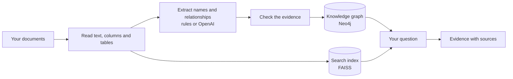

# Semantica Knowledge Graph Lab

**Turn your documents into a knowledge graph where every link shows its proof, then
test whether graph search answers your questions better than ordinary search.**

This is a small local lab for finding out what
[Semantica](https://github.com/semantica-agi/semantica) really does with documents.
It is a tool for experiments, not a chatbot: it shows you the evidence, and you judge
it.

Built with **Semantica 0.7.0**, Neo4j 5.26, FAISS, SQLite and Streamlit.

## Contents

* [The idea](#the-idea)
* [How it works](#how-it-works)
* [Quick start](#quick-start)
* [Try it with the sample documents](#try-it-with-the-sample-documents)
* [Use your own documents](#use-your-own-documents)
* [How to get the best results](#how-to-get-the-best-results)
* [Look at the graph in Neo4j Browser](#look-at-the-graph-in-neo4j-browser)

## The idea

Documents contain facts: who built what, which system uses which database, what is
part of what. Ordinary search finds *passages* that look like your question. It does
not show how things are connected.

This lab:

1. reads your documents (PDF, DOCX, TXT, HTML);
2. finds the names in them and the relationships between those names;
3. checks every relationship against the text;
4. stores the result as a graph, keeping the source sentence for each link;
5. lets you ask the same question with vector search, graph search or both, and
   compare what comes back.

Use it to answer questions such as: *Can a knowledge graph be trusted for my
documents? Where did this fact come from? Do two documents disagree?*

## How it works



### Every relationship gets a status

| Status | Meaning | In the graph? |
|---|---|---|
| **Supported** | both names are in one sentence or one table row | yes |
| **Inferred** | follows from a section heading and its text; **not a confirmed fact** | yes, marked |
| **Rejected** | the text does not support it (for example it comes from a page footer) | no, but the record and the reason are kept |

"Supported" means the two names are stated together. The check cannot judge whether
the verb is right, so read the quote before you rely on a link. Details:
[evidence statuses](docs/architecture.md#evidence-statuses).

## What each page does

| Page | What you can do |
|---|---|
| Overview | totals, types, recent runs; load the sample data |
| Documents | upload, inspect what was extracted and discarded, reprocess, delete |
| Knowledge Graph | explore and search the graph, read the source of a link, shortest paths, ontology checks, reasoning, facts valid on a date |
| Query Playground | ask a question with vector, graph, hybrid or native retrieval, alone or side by side |
| Provenance & Conflicts | where each fact came from, contradictions between documents, merged names, integrity check, decision trace |
| Evaluation | compare the retrieval modes on the sample questions |

## Requirements

* Windows 10/11 (commands below are PowerShell; the code is not Windows-specific)
* Python 3.12 recommended (3.11 or 3.13 should work; **3.14 is not supported** by Semantica)
* Docker Desktop, for Neo4j
* About 2.5 GB of disk space, and internet access for the first install

## Quick start

Run these from the project folder.

**1. Create the Python environment**

```powershell
py -3.12 -m venv .venv
```

```powershell
.\.venv\Scripts\python.exe -m pip install -r requirements-dev.txt
```

For an exact copy of the tested dependency tree use `requirements.lock.txt` instead.

**2. Create your settings file.** This command leaves an existing `.env` alone.

```powershell
if (-not (Test-Path .env)) { Copy-Item .env.example .env }
```

Open `.env` and set `NEO4J_PASSWORD` (at least 8 characters). Never commit `.env`.

**3. Start the database** (Docker Desktop must be open)

```powershell
docker compose up -d --wait neo4j
```

**4. Start the application**, then open <http://localhost:8501>

```powershell
.\.venv\Scripts\python.exe -m streamlit run app\main.py
```

The first run downloads the local search model (about 70 MB). After that, rule-based
extraction and search work offline.

**Next time**, only steps 3 and 4 are needed.

## Try it with the sample documents

Six short documents about a fictional company, Acme AI, are included. They need no
API key. Load them with the **Load sample documents** button on the Overview page
(shown while the lab is empty), or run:

```powershell
.\.venv\Scripts\python.exe scripts\load_sample_data.py
```

> The command adds the samples to whatever is already stored. To keep your own graph
> clean, load samples only into an empty lab.

Press **Reload resources** in the app's sidebar after running a script. Then open
**Query Playground**, keep **Hybrid GraphRAG**, and ask:

| Question | What you should find |
|---|---|
| Which projects use PostgreSQL? | Project Atlas and Project Cobalt |
| Who leads the team responsible for VisionCore? | Sarah Chen, plus a conflicting claim from another document |
| Which facts about VisionCore have conflicting sources? | launch year, primary database and team lead |
| How is Northwind Robotics connected to PostgreSQL? | a path through Acme AI and VisionCore |
| What is the annual revenue of Globex Corporation? | an "Insufficient evidence" warning, because no document says it |

Then press **Compare all modes** on the same question to see how the retrieval modes
differ.

## Use your own documents

The offline rules were written for the sample documents. On other material they find
few or no relationships, so use **AI extraction with OpenAI** for your own files.

1. Create an API key in your OpenAI account and make sure it has credit.
2. In `.env`, set `OPENAI_API_KEY=` followed by the key.
3. Restart the app.
4. On **Documents**, upload files, or select an uploaded document, choose
   **AI extraction with OpenAI** and click **Reprocess**.
5. Check the results on **Knowledge Graph** and **Query Playground**.

> **Your document text is sent to OpenAI and billed to your account.** When a key is
> set, the AI method is selected by default on the Documents page, so check the method
> before you upload. Each passage costs up to two requests.

What AI extraction does differently:

* sends the text in passages of up to about 1,800 characters instead of sentence by
  sentence;
* adds a **Concept** type and the relations `IS_A`, `ENABLES`, `USED_FOR`,
  `EVALUATES` and `RELATED_TO`;
* restricts the model to the allowed types, and rejects names that do not appear in
  the text;
* checks every relationship afterwards and gives it a status.

If any request fails, the document is marked `failed` and its earlier facts are kept.
The Query Playground can also write an answer from the evidence, shown apart from it.

> AI extraction has been tried against the real OpenAI service on a single PDF.
> Answer generation is covered only by tests with a stand-in client.

## How to get the best results

1. **Start with one document you know well.** You can then see quickly what is right,
   missing or wrong.
2. **Use digital documents with clear headings.** Two-column PDF pages and tables with
   visible borders are handled. Scanned pages are not (no OCR).
3. **Read the proof, not just the link.** Trust a *supported* link after reading its
   quote. Check an *inferred* link yourself.
4. **Name the thing you ask about.** "What does VisionCore depend on?" works better
   than "What do the products need?".
5. **Pick the right mode.** *Vector* finds passages. *Graph* follows connections and
   paths. *Hybrid* does both and is a good default.
6. **Look below the warning.** The "Insufficient evidence" limit was set on the sample
   documents; on your own files the answer may still be in the results.
7. **Look for disagreements and duplicates** on Provenance & Conflicts.
8. **Back up the `data` folder and the Neo4j volume** before large changes.

## Look at the graph in Neo4j Browser

Open <http://localhost:7474> and sign in as `neo4j` with your `NEO4J_PASSWORD`. Paste
one query at a time; this window understands the Cypher query language, not English.

All relationships:

```cypher
MATCH (a:Entity)-[r]->(b:Entity) RETURN a, r, b
```

Only directly supported relationships:

```cypher
MATCH (a:Entity)-[r]->(b:Entity) WHERE r.support_status = 'supported' RETURN a, r, b
```

Only inferred relationships (the sample documents have none):

```cypher
MATCH (a:Entity)-[r]->(b:Entity) WHERE r.support_status = 'inferred' RETURN a, r, b
```

Every relationship with its status and proof:

```cypher
MATCH (a:Entity)-[r]->(b:Entity) RETURN a.name AS source, type(r) AS link, b.name AS target, r.support_status AS status, r.evidence_quotes[0] AS evidence
```

Everything connected to one name (sample data):

```cypher
MATCH (a:Entity {name:'VisionCore'})-[r]-(b:Entity) RETURN a, r, b
```

How two names are connected (sample data):

```cypher
MATCH p = shortestPath((a:Entity {name:'Northwind Robotics'})-[*..6]-(b:Entity {name:'PostgreSQL'})) RETURN p
```

## What the evaluation found (sample documents)

* All four retrieval modes answered **13 of 15** questions correctly, failing on
  different ones. GraphRAG was **not** better overall.
* At a similar evidence size, plain vector search covered **more** of the expected
  answers than graph retrieval. The set of documents is tiny (11 chunks), which
  favours it.
* Graph retrieval was the only mode that handled the "who led this team in 2024"
  question without also returning the later lead, and it adds paths and conflicts.
* The offline pattern extraction scores 0.98 recall on the sample documents but only
  **0.27** on reworded sentences. Semantica's unmodified `pattern` method found no
  domain facts at all.

Read [the full results and their limits](docs/evaluation_results.md) before drawing
conclusions.

## Configuration (`.env`)

| Variable | Default | Meaning |
|---|---|---|
| `NEO4J_URI` / `NEO4J_USER` / `NEO4J_PASSWORD` | `bolt://localhost:7687` / `neo4j` / – | graph database |
| `NEO4J_TEST_URI` | `bolt://localhost:7688` | database for integration tests |
| `OPENAI_API_KEY` | empty | enables AI extraction and answers |
| `OPENAI_MODEL` | `gpt-6-luna` | see OpenAI's [models](https://developers.openai.com/api/docs/models) and [deprecations](https://developers.openai.com/api/docs/deprecations) |
| `OPENAI_REASONING_EFFORT` | `low` | `none` to `max`; higher uses more output tokens |
| `EMBEDDING_MODEL` | `BAAI/bge-small-en-v1.5` | any FastEmbed model; delete `data\vector_index` after changing it |
| `DATA_DIR` | `./data` | runtime state |
| `MAX_UPLOAD_MB` | `10` | upload limit (also set in `.streamlit/config.toml`) |
| `LOG_LEVEL` | `INFO` | application logging |

## Other commands

Run scripts while the app is idle, then press **Reload resources** in the sidebar.

Compare the retrieval modes on the sample documents:

```powershell
.\.venv\Scripts\python.exe scripts\run_evaluation.py
```

Stop the database (your data is kept):

```powershell
docker compose down
```

Start again from the samples. **This deletes all stored documents, including your
own:**

```powershell
.\.venv\Scripts\python.exe scripts\load_sample_data.py --reset
```

## Tests

Unit tests need no database and no API key:

```powershell
.\.venv\Scripts\python.exe -m pytest
```

Integration tests (Neo4j and the UI) use a separate, disposable container, because
they delete everything in the database they run against:

```powershell
docker compose --profile test up -d --wait neo4j-test
```

```powershell
.\.venv\Scripts\python.exe -m pytest -m integration
```

To check that everything survives a restart, compare two fingerprints of the stored
state (the two outputs should be identical):

```powershell
.\.venv\Scripts\python.exe scripts\snapshot.py
```

```powershell
docker compose down; docker compose up -d --wait neo4j
```

```powershell
.\.venv\Scripts\python.exe scripts\snapshot.py
```

## Limitations

**Extraction**
* The offline method is a rule-based pattern pack written for the sample domain. It does not
  resolve pronouns, passive or nominal phrasings it has no rule for, lists of
  subjects, or people mentioned away from a recognised verb.
* It produces false positives, for example the heading "Project Register" becomes a
  project.
* Confidence values are not calibrated probabilities.
* Scanned PDFs are rejected (no OCR). Tables without visible borders may lose their
  structure.
* The evidence check matches names by spelling, so it can reject a link that a human
  reader would accept (for example when the text says "agents" instead of the full
  name).

**Resolution and conflicts**
* Merging relies on spelling rules, a small alias table and a first-name rule.
  Candidates for review are listed, but there is no button to accept or reject them.
* Conflicts are detected only for `launch_year`, `primary_database` and a team's lead.
* Validity dates are read only from `from … until …` / `since …` with ISO dates.

**Retrieval and display**
* Graph and hybrid ranking is a heuristic written here. Graph mode misses a three-hop
  question in the evaluation.
* "Insufficient evidence" thresholds were tuned on the same small question set.
* Retrieval returns evidence; without an LLM no answer is composed.
* Retrieved evidence labels inferred links, but the Knowledge Graph, Documents and
  Provenance pages do not show the status yet.

**Operations**
* Single user, no authentication; both servers listen on `127.0.0.1` only.
* Writes across Neo4j, FAISS, provenance and SQLite are not one transaction.
  Reprocess a document if a run was interrupted.
* The whole graph is re-derived on each ingestion and loaded for querying, which will
  not scale far.
* Two files with the same name but different content are both kept.
* Semantica's precedent search does not work on Neo4j in this release.
* Decisions survive re-processing, but lose their link to any entity that disappears
  (for example after deleting its documents or running `--reset`).

## Troubleshooting

| Symptom | Fix |
|---|---|
| "Cannot connect to Neo4j" | open Docker Desktop, then `docker compose up -d --wait neo4j` |
| Authentication fails after editing the password | Neo4j keeps the first password in its volume. `docker compose down -v` (**deletes the graph**), then start and reload |
| Port 7474, 7687 or 8501 in use | stop the other service or change the mapping |
| "Embedding model did not load" | the first run needs internet access |
| "litellm library not installed" messages | harmless |

## More documentation

| Document | Content |
|---|---|
| [docs/semantica_integration.md](docs/semantica_integration.md) | what is Semantica and what is this app, plus 26 surprises found along the way |
| [docs/evaluation_results.md](docs/evaluation_results.md) | measured comparison and what it does and does not show |
| [docs/architecture.md](docs/architecture.md) | diagram, processing flow, design decisions |
| [docs/database_design.md](docs/database_design.md) | what each store owns |
