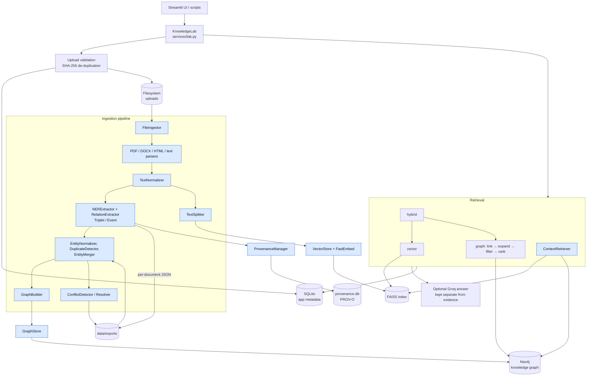

# Architecture

Shaded nodes are Semantica modules; the rest is application code or infrastructure.



## Processing flow

1. **Register.** Validate type and size; hash the bytes. A hash that was already
   processed is skipped; a hash that previously failed is retried.
2. **Parse** with Semantica and record page / section offsets.
3. **Extract** sentence by sentence, so each fact has an exact quote and span.
4. **Rebuild the graph** from all per-document extraction artifacts: resolve entities,
   aggregate evidence per edge, detect conflicts.
5. **Synchronise Neo4j** (create, update, delete only what changed). This runs first
   because it is the step most likely to fail; if it does, the other stores are not
   touched and the document is marked `failed`.
6. **Index chunks** in FAISS, **record provenance**, invalidate facts that disappeared,
   then write the artifacts.

## Design decisions

| Decision | Why | Cost |
|---|---|---|
| Re-derive the graph from per-document extractions | reprocessing or deleting a document cannot leave stale facts; entity resolution stays global | work grows with the corpus; fine for hundreds of documents, not millions |
| Keep extraction artifacts as JSON | needed to re-resolve and to detect conflicts between sources | they are an intermediate, not a second graph: nothing queries them for retrieval |
| Retrieval reads the graph from Neo4j | the persisted graph is the one that is tested | the whole graph is loaded per query engine |
| Disable `GraphBuilder` merging | its fuzzy default produced false merges | resolution policy is application code |
| Never auto-resolve conflicts | the requirement is to surface them | disputed attributes have no single scalar value |
| One orchestrator, no service layers or queues | local single-user lab | ingestion blocks the UI; no concurrent writers |

The cross-store write is **not atomic**. A crash between step 5 and step 6 leaves Neo4j
ahead of the other stores; reprocessing the document repairs it.

## Layout

```
app/            Streamlit entry point, pages, shared UI helpers
backend/
  ingestion/    validation, parsing, chunking
  extraction/   pattern pack, sentence offsets, extractor orchestration
  graph/        resolution, assembly, conflicts, Neo4j, reasoning, visualisation
  provenance/   ProvenanceManager wrapper
  retrieval/    FAISS index, query modes, answer generation
  ontology/     vocabulary, OWL / SHACL service
  evaluation/   metrics, runner, report
  services/     orchestrator, document registry, decisions
database/       SQLAlchemy models, session, migrations
data/           sample corpus (versioned) and runtime state (ignored)
scripts/        sample data, loading, evaluation
tests/          unit tests; tests/integration needs Neo4j
```
