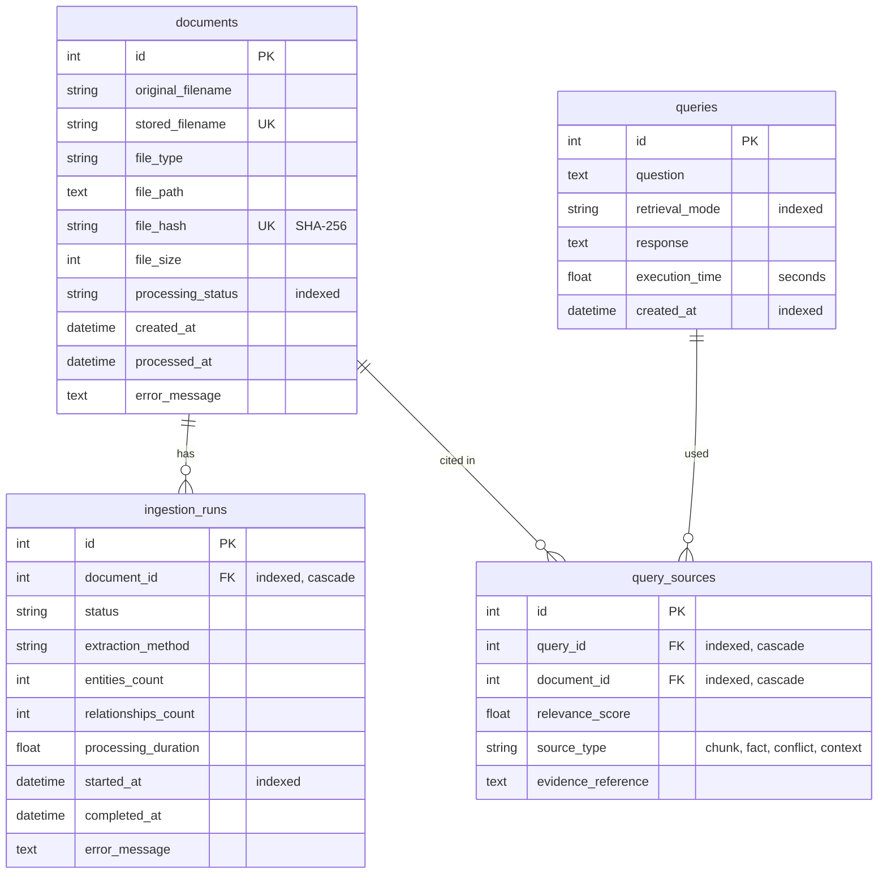

# Storage design

| Store | Owns | Written by | Rebuildable from |
|---|---|---|---|
| Neo4j | the knowledge graph (entities, relationships, decisions) | Semantica `GraphStore`, `AgentContext` | extraction artifacts (decisions are **not** rebuildable) |
| `data/provenance.db` | PROV-O lineage of every extracted statement | Semantica `ProvenanceManager` | no: it is the audit history |
| FAISS (`data/vector_index/chunks`) | chunk embeddings and chunk metadata | Semantica `VectorStore` | uploaded files |
| SQLite (`data/app_metadata.db`) | documents, runs, query log | SQLAlchemy | no |
| Filesystem (`data/uploads`) | original files, named by content hash | application | no |
| `data/exports` | per-document extractions, conflict analysis, graph snapshot, evaluation | application | uploaded files |

The knowledge graph is not stored in SQLite.

## SQLite

* Foreign keys are enforced (`PRAGMA foreign_keys=ON`).
* `file_hash` is unique; that constraint is the duplicate-ingestion guarantee.
* Deleting a document cascades to its runs and source citations; the query itself stays.
* Migrations: `database/migrations` applies numbered steps once and records them in
  `schema_migrations`.

## Neo4j

The storage model is Semantica's: labelled property-graph nodes and typed
relationships. Property values must be primitives or lists, so evidence is stored as
parallel lists.

How the logical data requirements map onto it:

| Requirement | Where it lives |
|---|---|
| entity id, name, normalised name, created / updated | node properties `id`, `name`, `normalized_name`, `created_at`, `updated_at` |
| entity type | property `type`, and the second node label |
| relationship type | the Neo4j relationship type |
| source and target entity ids | `source_entity_id`, `target_entity_id` |
| confidence | `confidence` (when the extractor reports one) |
| source reference, extraction method and time, location | `provenance_ids`, `source_documents`, `evidence_*`, `extraction_method`, `extracted_at`, and the provenance store |

**Nodes**, labels `Entity` plus the entity type (for example `:Entity:Product`):

| Property | Meaning |
|---|---|
| `id` | stable id, `product:visioncore` (indexed) |
| `name`, `normalized_name`, `type` | canonical name and entity type |
| `aliases` | other surface forms found |
| `source_documents`, `document_ids`, `mention_count` | where it was mentioned |
| `confidence` | extractor-reported value |
| `launch_year`, `launch_year_values`, … | claimed attribute values; the scalar is set only when undisputed |
| `created_at`, `updated_at`, `managed_by` | bookkeeping |

**Relationships**, typed (`LEADS`, `DEPENDS_ON`, …):

| Property | Meaning |
|---|---|
| `id` | stable hash of source, type, target, `valid_from` |
| `source_entity_id`, `target_entity_id` | endpoint ids |
| `confidence` | highest extractor value |
| `provenance_ids` | keys into the provenance store, one per supporting statement |
| `evidence_documents`, `evidence_locations`, `evidence_quotes` | aligned lists |
| `source_documents`, `document_ids` | distinct supporting documents |
| `extraction_method`, `extracted_at` | how and when |
| `valid_from`, `valid_until` | validity period, when stated |

**Decisions** (Semantica's own model): `(:Decision {decision_id, category, scenario,
reasoning, outcome, confidence, timestamp, …})-[:ABOUT]->(:Entity)`.

## Provenance store

One entry per document (`document:<id>`) and one per statement
(`fact_<hash of document, subject, predicate, object, position>`), the latter derived
from the former. Re-processing appends a new version; deletion of a source marks its
facts `invalidated`. Entries are hash-chained.

## FAISS

Flat L2 index over unit-length 384-dimensional embeddings. Per vector:
`chunk_id` (`doc<id>-c<n>`), `document_id`, `filename`, `text`, `start`, `end`,
`location`, and `content` (read by `ContextRetriever`).

## Backup and reset

Neo4j lives in the Docker volume `semantica-lab_neo4j_data`; everything else is under
`data/`. `scripts/load_sample_data.py --reset` removes documents and derived data but
deliberately keeps provenance history. For a completely clean start, stop the app,
delete `data/*.db`, `data/uploads`, `data/vector_index` and `data/exports`, and run
`docker compose down -v`.
